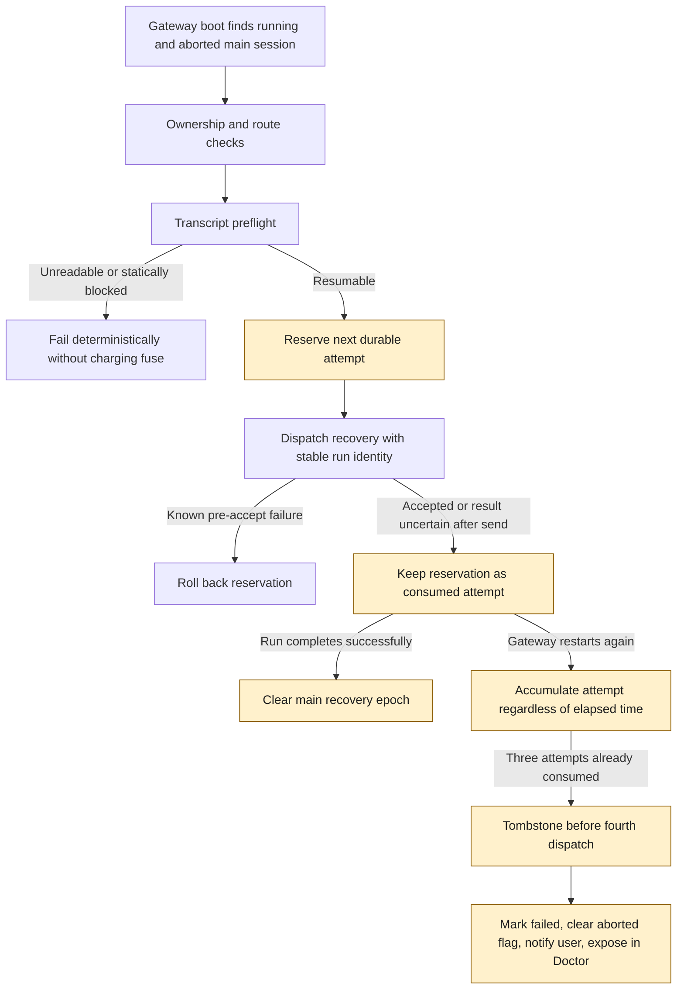

## Background

Main-session restart recovery currently receives a fresh process-local retry budget whenever the
Gateway starts. A session that repeatedly wedges after an automatic resume can therefore keep
restarting the Gateway until the external supervisor stops it.

Subagent orphan recovery already has a durable fuse and tombstone. Its state model is reusable, but
its two-minute rapid re-wedge policy is not: subagent recovery is scanned repeatedly inside one
process, while main-session recovery normally runs once per Gateway boot. Gateway boots can be
separated by minutes or hours, so elapsed time is not a useful reset boundary for main sessions.

## Goals

- Bound automatic main-session recovery across Gateway boots.
- Count recovery dispatches only after transcript preflight has established that the session is
  resumable.
- Preserve a reservation when dispatch acceptance is confirmed or cannot be disproved after the
  request was sent.
- Reset the durable budget only after successful completion or explicit session replacement.
- Reuse the recovery fuse state model and pure transitions without sharing owner-specific policy.
- Make main-session tombstones visible and actionable in Doctor.

## Non-goals

- Do not change the subagent two-minute rapid re-wedge policy.
- Do not combine the durable cross-boot budget with process-local startup and RPC retry orchestration.
- Do not make the budget configurable.
- Do not use `restartRecoveryRuns` as the canonical retry counter.
- Do not automatically retry a statically unresumable or unreadable transcript.

## Key surfaces

| Surface                                       | Responsibility                                                                           |
| --------------------------------------------- | ---------------------------------------------------------------------------------------- |
| `src/agents/restart-recovery-fuse.ts`         | Shared pure fuse evaluation and tombstone transitions                                    |
| `src/agents/main-session-recovery-state.ts`   | Main-session cumulative policy and legacy normalization                                  |
| `src/agents/main-session-restart-recovery.ts` | Transcript preflight, durable reservation, dispatch, notice, and tombstone orchestration |
| `src/gateway/session-lifecycle-state.ts`      | Successful-completion reset boundary                                                     |
| `src/config/sessions/types.ts`                | Canonical persisted recovery fuse state shape                                            |
| `src/commands/doctor-state-integrity.ts`      | Tombstone diagnostics and stale abort-marker repair                                      |

## Core design

## Policy contract

| Decision              | Main session                                          | Subagent                              |
| --------------------- | ----------------------------------------------------- | ------------------------------------- |
| Durable state         | Shared recovery fuse shape                            | Shared recovery fuse shape            |
| Attempt window        | No elapsed-time expiry                                | Two-minute rapid re-wedge window      |
| Automatic budget      | Three consumed attempts; tombstone before the fourth  | Existing owner policy                 |
| Reset boundary        | Successful completion or explicit session replacement | Existing owner policy                 |
| Process-local retries | Separate transient availability guard                 | Separate transient availability guard |

A known failure before Gateway acceptance does not consume the durable budget. A timeout or transport
loss after sending cannot prove non-acceptance, so the reservation remains consumed. This conservative
boundary prevents a lost acknowledgement from reopening the restart loop.

Ordinary inbound metadata, route updates, command admission, and a user turn that has not completed do
not reset the fuse. Explicit `/new` or session reset replaces the recovery epoch. Successful terminal
completion clears `mainRestartRecovery` and the associated lifecycle suppression markers while leaving
`subagentRecovery` untouched.

## Doctor and legacy state

Doctor reports every main-session recovery tombstone with representative session keys and reasons.
Canonical tombstones remain blocked until the user starts a replacement session or a run completes
successfully. Doctor repair clears only an inconsistent stale `abortedLastRun` flag that coexists with
a tombstone; it does not silently re-enable automatic recovery.

Released rows that predate `mainRestartRecovery` may use distinct `restartRecoveryRuns` markers as a
conservative one-time attempt floor. New attempts always use `mainRestartRecovery`; lifecycle markers
remain responsible for ignoring late events rather than becoming the canonical budget.

## Verification plan

### Agent self-validation

- Focused main-session recovery tests cover three accepted or uncertain attempts across slow Gateway
  restarts, then tombstone before a fourth dispatch.
- Recovery tests prove known pre-accept failures roll back while ambiguous transport failures retain
  the reservation.
- Lifecycle and command tests prove successful completion and explicit session replacement reset the
  fuse, while ordinary admission and metadata writes do not.
- Doctor tests prove canonical tombstones are reported and only stale aborted markers are repaired.
- Existing subagent recovery tests prove its two-minute policy remains unchanged.
- Changed type, lint, and architecture gates pass through the repository remote validation path.

### Human acceptance

No additional manual acceptance is required beyond reviewing the operator-facing attempt limit and
reset policy.
